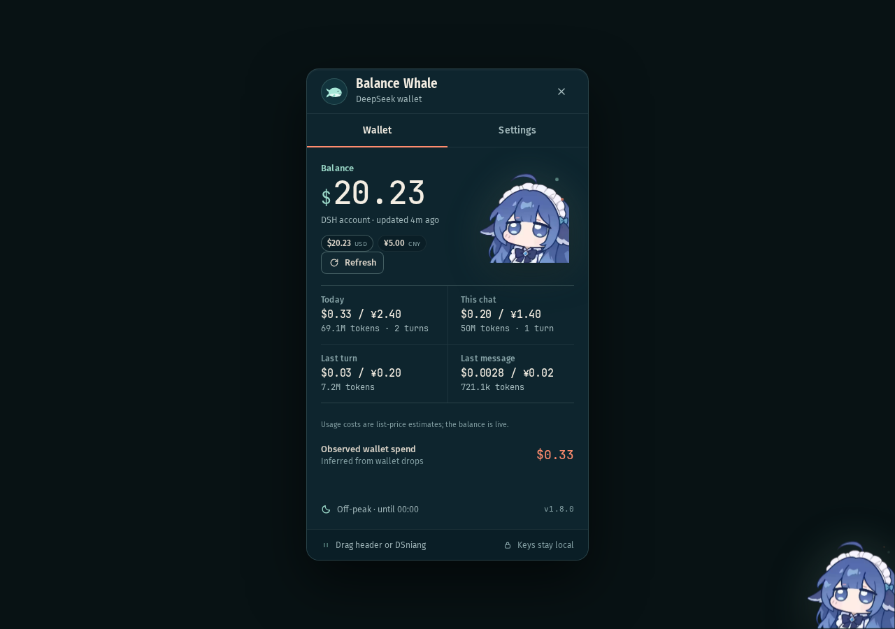

# Balance Whale Intl

**English-first DeepSeek wallet companion for the [DSH Web UI](https://github.com/deepseek-ai/deepseek-harness).**

Live wallet balance, real token usage, per-turn cost estimates, sounds, and a draggable card — with **English as the default language** and **简体中文** included.




## Why this fork

The upstream [DeepSeek Balance Whale Widget](https://github.com/MeteorNOX/DeepSeek-Balance-Whale-Widget) is Chinese-first: its README is Chinese-only and the shipped interface is Chinese. I built this version because I wanted the same whale-girl companion, live balance, usage view, sounds, and turn notifications in English.

English is the default here. Simplified Chinese remains available in **Settings → Appearance → Language**, so the widget is still usable by the original audience.

This is an independent fork. It is not affiliated with or endorsed by the upstream author.

## Features

- **English by default, 简体中文 included** — switch the whole UI instantly, including labels, notices, dates, counts, status messages, and known balance errors.
- **Live wallet balance** — CNY and USD wallets are shown separately when both exist.
- **Real usage data** — today, current chat, last turn, and last message, using token counts from DSH session logs.
- **Cost estimates** — list-price estimates in Auto, CNY, or USD. The wallet balance itself always stays automatic.
- **Draggable card** — drag the card by its header; double-click the header to re-center it. Position is remembered.
- **Character placement** — drag the character, snap to edges, and mirror it automatically when docked left.
- **Turn and waiting notices** — optional turn-cost bubble, question/approval chimes, and a waiting notice beside the character.
- **Sound presets** — Duck, FX1, Minecraft orb, Task-end A, or Cost, with per-sound previews and volume.
- **Appearance controls** — character, size, animations, glow, secondary currencies, and auto-close.
- **Local-only settings** — preferences are saved in the browser on this device.

### 中文简介

这是 Balance Whale 的英文优先分支。上游项目以中文为主，此版本默认英文，并在「设置 → 外观 → 语言」中保留完整的简体中文界面。余额、今日/本次对话用量、每轮费用、音效、拖拽与吸附等功能都已保留。

## Install

### Requirements

- A DSH Web installation with third-party bundle support (`dsh web`).
- For the wallet balance: a `DEEPSEEK_API_KEY` in DSH's credential service, or a signed-in DeepSeek account.
- Usage statistics still work when balance lookup is unavailable.

### From GitHub

```sh
dsh plugin --profile web add github:Biggy1606/dsh-balance-whale-intl
```

For a reproducible install, pin the release tag:

```sh
dsh plugin --profile web add github:Biggy1606/dsh-balance-whale-intl#v1.8.0
```

### From npm

When the npm release is available:

```sh
dsh plugin --profile web add dsh-balance-whale-intl
```

### After installing

Restart `dsh web`, then hard-refresh the browser page (`Ctrl+Shift+R`). If the widget does not appear, check that **Balance Whale Intl** is enabled under **Settings → Plugins**.

### Update or remove

```sh
dsh plugin --profile web remove dsh-balance-whale-intl
dsh plugin --profile web add github:Biggy1606/dsh-balance-whale-intl
```

## Using it

1. The character lives in the bottom-right corner of the DSH window.
2. Click it to open or close the wallet card.
3. Drag the character to move it; release near an edge to snap.
4. Drag the card by its **header** to move it; double-click the header to re-center.
5. Open **Settings → Appearance → Language** to switch between English and 简体中文.
6. Close the card with **×**, **Esc**, or by clicking the character again.

## How the numbers work

- **Tokens are real.** DSH session logs provide the input, cached, and output token counts.
- **Costs are estimates.** They use DeepSeek list prices and do not include discounts, exchange-rate differences, or promotional pricing.
- **Dual currency is one charge, not two.** When both wallets have been used, the same token usage is priced in CNY and USD.
- **Observed wallet spend** is inferred from balance drops while the plugin is running. It is not retroactive and cannot attribute a charge to a specific wallet when both currencies are mixed in one turn.
- The balance lookup uses `DEEPSEEK_API_KEY` first, then the signed-in DeepSeek account.

## Data and privacy

- API keys stay in DSH's credential service and never enter the widget's browser code.
- Balance resolution runs in the host process.
- There is no telemetry, analytics, or remote logging.
- Network requests go to DeepSeek's balance API (through the host) and to DSH's local `/balance-whale/*` routes.
- The local ledger at `$DSH_HOME/.balance-whale.json` stores accounting keys, token counts, costs, model/turn names, and the latest turn. It does not store prompts, replies, credentials, or API keys.
- `/balance-whale/state.json` and `/balance-whale/wait.json` are read-only and reject cross-site requests.

## Troubleshooting

**The widget is missing.**  
Hard-refresh with `Ctrl+Shift+R`; if it is still missing, restart `dsh web` and check **Settings → Plugins**.

**There is no sound.**  
Check the volume slider, the master sound switch, and the browser tab/system audio. Preview buttons work even when the master sound switch is off.

**Balance is unavailable.**  
Add a `DEEPSEEK_API_KEY` in DSH or sign in to a DeepSeek account. Usage statistics do not require a balance lookup.

**The cost differs from my DeepSeek bill.**  
The token usage is real; the cost is a list-price estimate. Mixed CNY/USD charging, exchange rates, or promotional pricing can make the platform charge differ.

**I want the original layout back.**  
Open **Settings → About → Restore defaults** to reset the widget settings and center the card. The selected language is kept.

**The character does not sit exactly at the edge.**  
Make sure **Snap to edges** is enabled, then drag close to the edge and release.

## Development

The browser client is generated from `ui.html`, `ui.css`, and `ui.js` into `client.js`. Edit the source files, then rebuild:

```sh
npm run build
npm run check
```

`npm run check` verifies that `client.js` embeds the current UI source, that the package and bundle names agree, and that the JavaScript parses.

```text
index.js              host: balance lookup, usage ledger, local JSON routes
client.js             generated DSH client bundle
client.template.js    wrapper used by scripts/build.mjs
ui.html               widget markup
ui.css                widget styles and design tokens
ui.js                 UI controller and i18n catalogs
locale/en.json        plugin metadata (English)
locale/zh.json        plugin metadata (Simplified Chinese)
scripts/build.mjs     reproducible client bundler
scripts/check.mjs     bundle and metadata checks
assets/               character art, icon, and audio
preview.png           English preview
preview-zh.png        Simplified Chinese preview
ASSET_PROVENANCE.md   asset source, checksums, and as-is terms
NOTICE                third-party notices
```

The client uses a Shadow DOM host and registers a `shell.overlay` slot. The host plugin reads the DSH balance API and session logs; the browser code only talks to the local `/balance-whale/*` routes.

## Compatibility

Built for the DSH Web UI (`dsh plugin --profile web`). The plugin declares `dsh.bundle.patch` and a `dsh.client` entry in `package.json`; dsh.so lists compatibility as **Declared** until it is independently tested.

## License and assets

The JavaScript, CSS, and this repository's own code are **MIT-licensed**. See [LICENSE](./LICENSE).

The character art, icon, GIF, and sounds come from the upstream project and are redistributed **as-is**. They are **not** MIT-licensed by the upstream project; see [ASSET_PROVENANCE.md](./ASSET_PROVENANCE.md) and [NOTICE](./NOTICE). Do not relicense the art or audio under this repository's MIT license.

Upstream project and original concept: [MeteorNOX/DeepSeek-Balance-Whale-Widget](https://github.com/MeteorNOX/DeepSeek-Balance-Whale-Widget).

## Version

`1.8.0`
